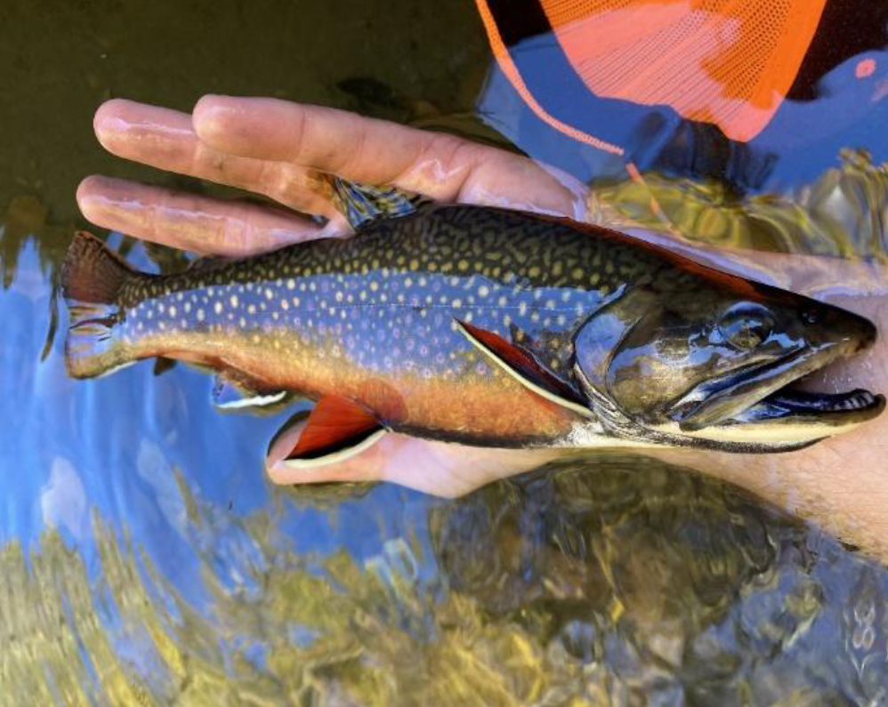

*This article was originally published in the Ithaca Times as part of [Innovations in Science](https://innovationsinscience.com). You can read this article as a PDF in its full typeface layout with beautiful pictures [here](https://innovationsinscience.com/_pdfs/IS_Peterson.pdf) .* 

Though the last autumn colors still dapple the hillsides, soon enough the winter holidays will have come and gone, and many will be looking to rid themselves of a dried-out pine tree or two. Allen Peterson, a retired fish and wildlife biologist, and his team of volunteers might be interested in turning some of them into fish houses. In what’s called a “conifer revetment”, discarded trees are laid end-to-end along riverbanks. These revetments protect against erosion and provide cover for young fish. 

Peterson is the Vice President of a local Trout Unlimited (TU) chapter out of Newark Valley. He organized the installation of over 100 used Christmas trees along the bank of East Branch Owego Creek as part of a broader habitat restoration effort for one of the region’s most beloved native game fish: brook trout. 

## A Multicolored Treasure

Every autumn, thousands of orange-bellied brook trout glide throughout the creeks that flow through Ithaca and the Finger Lakes region in search of the perfect gravelly streambed where they can reproduce, or spawn. Native to the cold freshwater rivers, ponds, and lakes of Eastern North America, spawning brook trout lay eggs in small nests built out of pebbles called redds. These fish are prized by anglers for their beauty and for the serene, remote forested streams they inhabit. 

Trout need clear, cold water to survive and places to hide from predators like mergansers and herons. For populations of these beloved fish to flourish, their spawning, summer and migratory habitats must be cared for.  

Peterson manages the ongoing TU Watershed Strategic Action program for Owego Creek and its tributaries, which exists to do just that. After retiring from his career as a wildlife biologist and business manager, Peterson—who earned his master’s degree studying brook trout spawning populations in the Catskills—was eager to marry his scientific training with his love of fishing to bolster the local trout population. 

## Habitat in Peril

The Owego Creek watershed in Tompkins, Cortland and Tioga Counties supports the largest and most intact brook trout ecosystem in western New York. Decades of development and deforestation have altered the many small creeks and tributaries that comprise the Owego Creek watershed and, from the trouts’ perspective, not for the better. The clearing of trees and shrubs in the riparian zone immediately bordering waterways left banks vulnerable to erosion. “Water velocity is a function of width,” Peterson explained. “When the channel gets too wide, the water slows down, sediment drops out of the current, and instead of having a nice stony bottom where trout and bugs hide, you just get mud.” 

Streams that were once fast flowing, curving their way through the forest, have since scoured away the unsupported banks. Now, these streams are wide, shallow, and warm, their beds thick with silt and sand. “The trout spawn up where the creek runs through the forest—they’re all happy—and when they try to scoot on down to Owego Creek, they have to go through Death Valley to get there,” said Peterson. Restoring the stream to its former curvy glory would provide deeper pockets of cold water, hiding spots for baby fish, and clear, swift currents. 

## Easing the Journey

In 2023, Peterson authored a 34-page, five-year plan for the Owego Creek program. Leaning on his scientific training, he ensured the plan began with data collection, trout population monitoring and various measures of water and habitat quality, before moving on to habitat improvement projects. The Owego Creek program’s data-driven approach allows volunteers and TU biologists to monitor the effects of restoration efforts on habitat quality and trout populations in real time. 

While Peterson’s own research has contributed to our understanding of local wild trout, the knowledge that drives this work is ancient. “People have written about the life cycle and ecology of trout since the Middle Ages,” he observed.

## A Community Effort 

Data collection and restoration efforts for the Owego Creek program span much of Tioga County, as well as Tompkins and Cortland counties. As Peterson notes, “This is a very large project, not just geographically, in scope, but in terms of who's involved.”

The coalition of agencies, community science partners, and volunteers who make the program possible were assembled by what Peterson refers to as horizontal advocacy. “In other words, we're not advocating upwards through layers of government, trying to get a leader to do something that they wouldn't normally do—we're going down to the grassroots to get people involved”.

Though the chief architects of the project are Peterson and a team of biologists at TU, its execution—literally—takes a village, and more.  The mayor of the Village of Newark Valley, was one of dozens of volunteers who helped install the Christmas tree revetment. The trees were collected in partnership with the Watermen Conservation Education Center out of Apalachin. Electrofishing for trout population assessments throughout the watershed is done by the New York State Department of Environmental Conservation. Specialists from the Tompkins and  Tioga County Soil and Water Conservation District plant rows of willow cuttings and other riparian trees and shrubs along restoration sites. Even highway superintendents are involved in re-installing problematic culverts that restrict water flow and are impassable to trout. 

“This is just a wonderful example of community involvement for something everybody can support and everyone can benefit from,” said Peterson. “I mean, who doesn’t love trout and clean streams?”   

*Trout Unlimited is a national non-profit organization with more than 300,000 members and supporters.  It works to care for and recover rivers and streams so our children can experience the joy of wild and native trout and salmon. www.TU.org.*          
        

